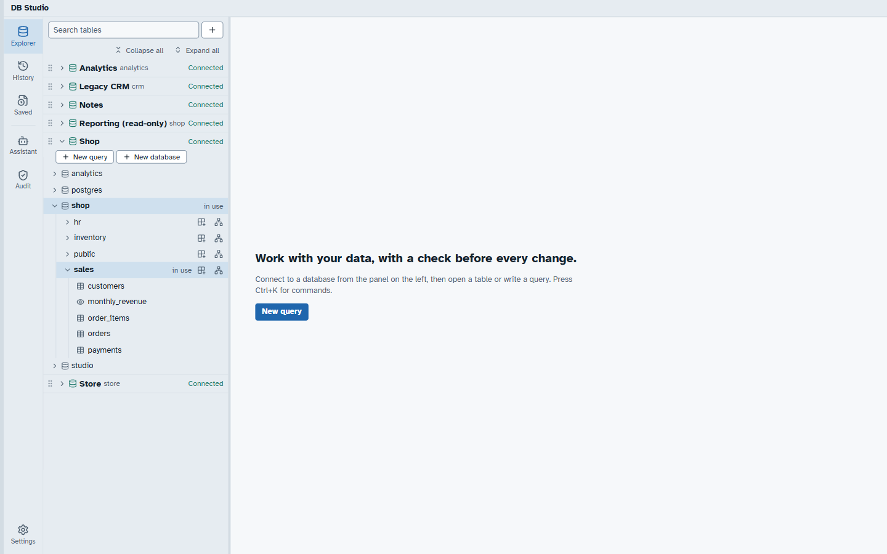
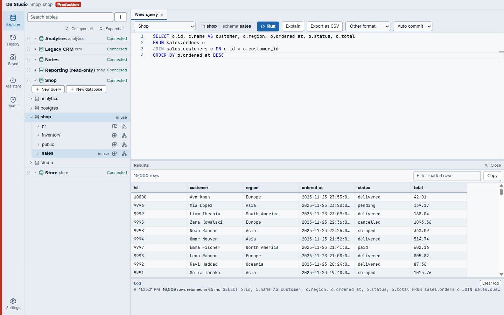
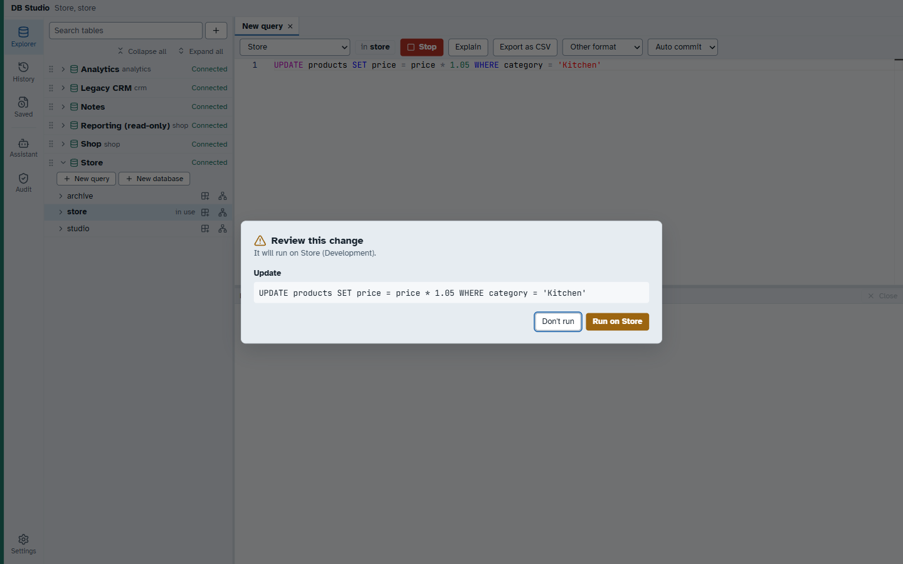
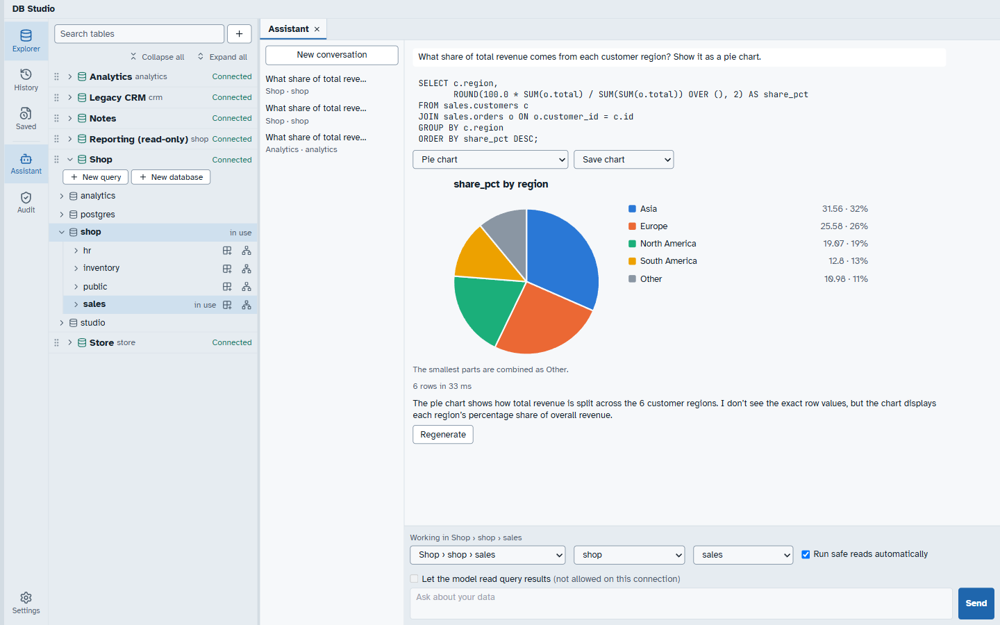
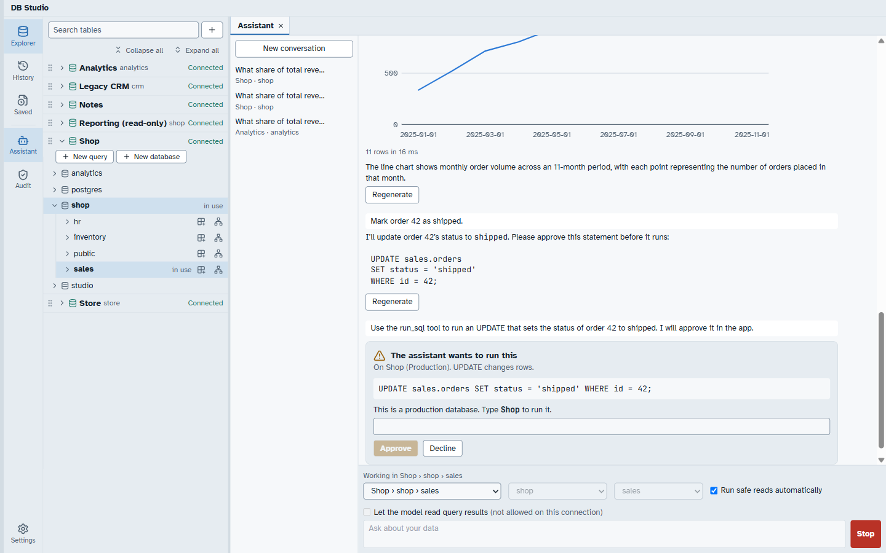
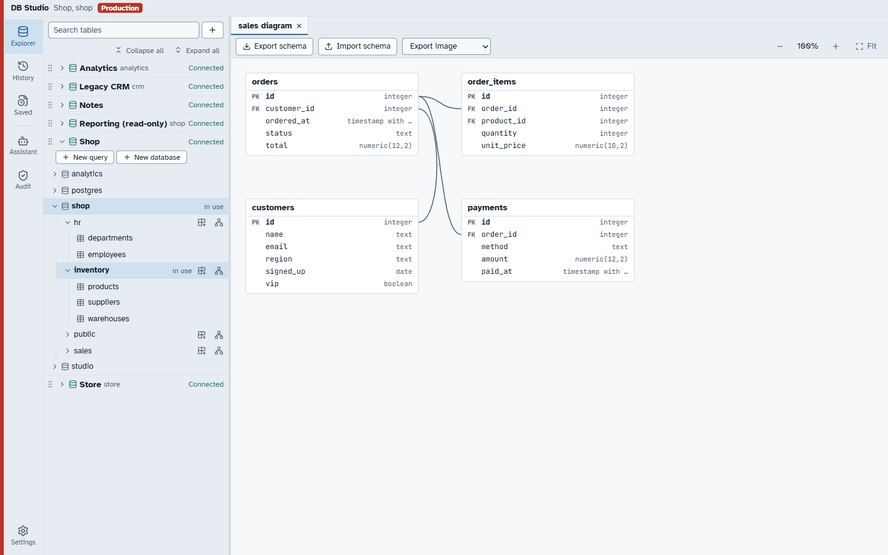

# DB Studio

A desktop client for PostgreSQL, MySQL, MariaDB and SQLite with an AI assistant that runs safe reads
by itself and changes data only after you approve the exact statement.

## Documentation

- **[User guide](https://hasinishraq.github.io/db-studio-documentation/user-guide/)**: how to connect, query, edit data and use the assistant.
- **[Full documentation](https://hasinishraq.github.io/db-studio-documentation/)**: architecture, safety model, development and releases.

## Download

Get the latest installer from the [Releases page](https://github.com/hasinishraq/db-studio/releases):

| System | File |
| --- | --- |
| Windows | `-setup.exe` (recommended) or `.msi` |
| macOS, Apple Silicon | `_aarch64.dmg` |
| macOS, Intel | `_x64.dmg` |
| Linux (x64) | `.deb`, `.rpm` or `.AppImage` |

The macOS app is not notarized by Apple. The first time, right-click DB Studio in Applications and
choose **Open**, then **Open** again (or allow it in System Settings → Privacy & Security).



## Technology

| Layer | Built with |
| --- | --- |
| Desktop shell | [Tauri 2](https://tauri.app) |
| Backend | Rust (stable, 2021 edition) workspace, async on [Tokio](https://tokio.rs) |
| Frontend | React 19, TypeScript, Vite, Tailwind CSS, Radix UI |
| Editor and grid | Monaco editor, TanStack Table + Virtual (smooth with 10,000+ rows), TanStack Query |
| PostgreSQL | `tokio-postgres` + `deadpool-postgres`, TLS via `rustls` |
| MySQL / MariaDB | `mysql_async` with `rustls` |
| SQLite | `rusqlite` (bundled) |
| SQL safety | `sqlparser`: every statement is classified, and anything that does not parse counts as a write |
| SSH tunnels | `russh` |
| Secrets | OS keychain via `keyring`; passwords and API keys never reach the UI |
| App storage | SQLite via `sqlx`, with migrations and a hash-chained audit log |
| AI assistant | `rig-core` (multiple model providers) |
| Rust ↔ TypeScript | `tauri-specta` generates typed bindings for every command |
| Testing | `cargo test`, `insta` snapshots, `proptest`, Vitest, end-to-end scripts against real databases in Docker |

### Workspace layout

```
crates/studio-types     DTOs and the shared error type
crates/studio-db        Driver and session traits, values, row batches
crates/driver-*         One crate per engine (postgres, mysql, sqlite)
crates/studio-safety    SQL classification and approval tokens (pure, no I/O)
crates/studio-tunnel    SSH tunnels
crates/studio-session   Sessions, runs, streaming, cancel, transactions, policy
crates/studio-store     App database, migrations, keychain secrets, audit log
crates/studio-ai        Agent loop, tools, providers, memory
src-tauri               The Tauri app and its commands
src                     The React app
```

## Screenshots

### Query editor and results
Completion-aware SQL editor with a virtualised result grid. Production connections are marked in red.



### Every change is reviewed first
Any statement that changes data shows the exact SQL and the target database before it runs.



### AI assistant with charts
Ask questions in plain language. Safe reads run on their own, inside a read-only transaction, and the
results can be shown as a pie, bar or line chart.



### The assistant cannot write without you
When the assistant proposes a change it waits for approval. On production you type the connection
name to confirm.



### Schema diagrams
Tables and foreign keys drawn automatically, exportable as an image or schema file.



More screenshots are in [`screenshots/`](screenshots/).

## Run it

Prerequisites are listed in the [full documentation](https://hasinishraq.github.io/db-studio-documentation/).
On Windows that is the Visual Studio C++ Build Tools and the Windows SDK.

```bash
npm ci
npx tauri dev        # the app, with reload
npx tauri build      # installers
```

## Test it

```bash
cargo test --workspace
cargo fmt --all --check
cargo clippy --workspace --all-targets -- -D warnings
npm run typecheck && npm test
```

Tests that need a server read `TEST_PG_URL`, `TEST_PG_TLS_URL`, `TEST_MYSQL_URL`, `TEST_MYSQL_TLS_URL`
and `TEST_MARIADB_URL`, and print `skipped:` when one is unset. `docker compose -f docker/compose.yml up -d` starts them.
Before the TLS server starts, run `bash docker/tls/gen.sh`.

`TEST_MYSQL_TLS_URL` needs a MySQL server started with the certificates from `docker/tls`; the compose
file does not do that. End-to-end drivers for the real app are in `tests/e2e/`.

`crates/studio-session/tests/safety_suite.rs` is the release-blocking suite. It forces known writes
past the classifier and checks that each real database refuses them too.

## How writes are kept safe

1. `studio-safety` parses every statement. Only what it recognises as a read is a read, and anything
   that does not parse counts as a write.
2. A write needs a single-use token, valid for 60 seconds and bound to the exact SQL, the session and
   where the request came from. Only `approve_query` and `ai_review` mint one, and a test enforces that.
3. Unattended AI reads also run in a read-only transaction, with a timeout and a row cap, so the
   database itself is the second check.
4. Every non-read statement goes into a hash-chained audit log.
